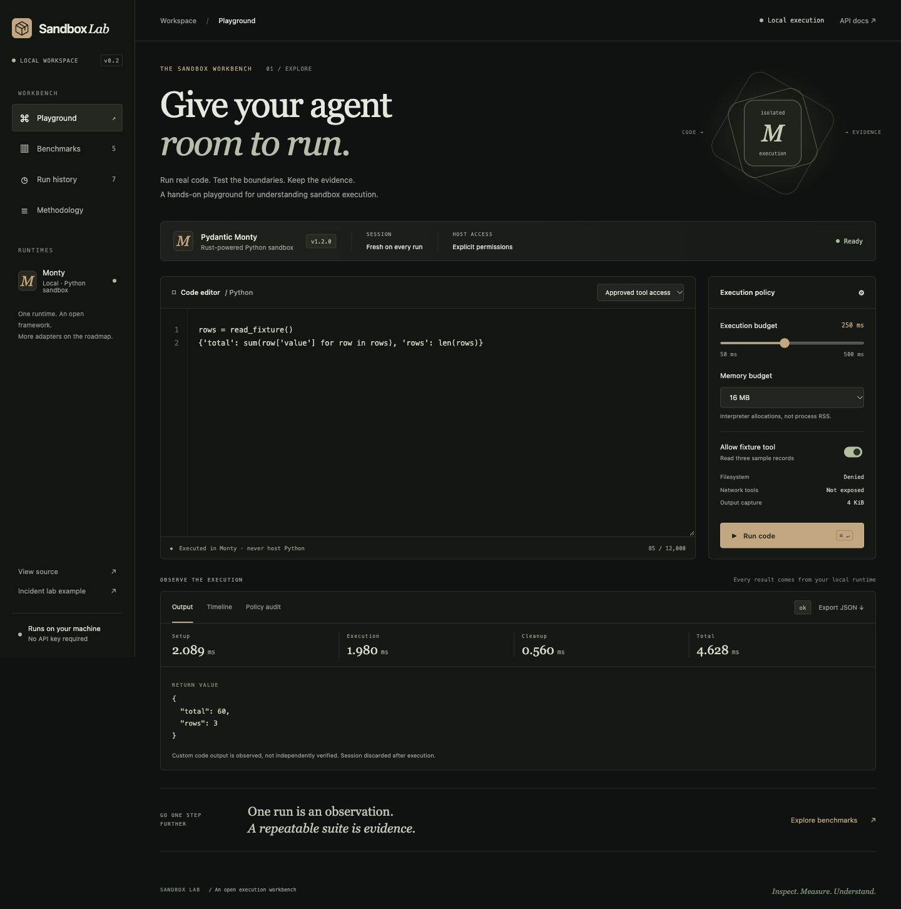
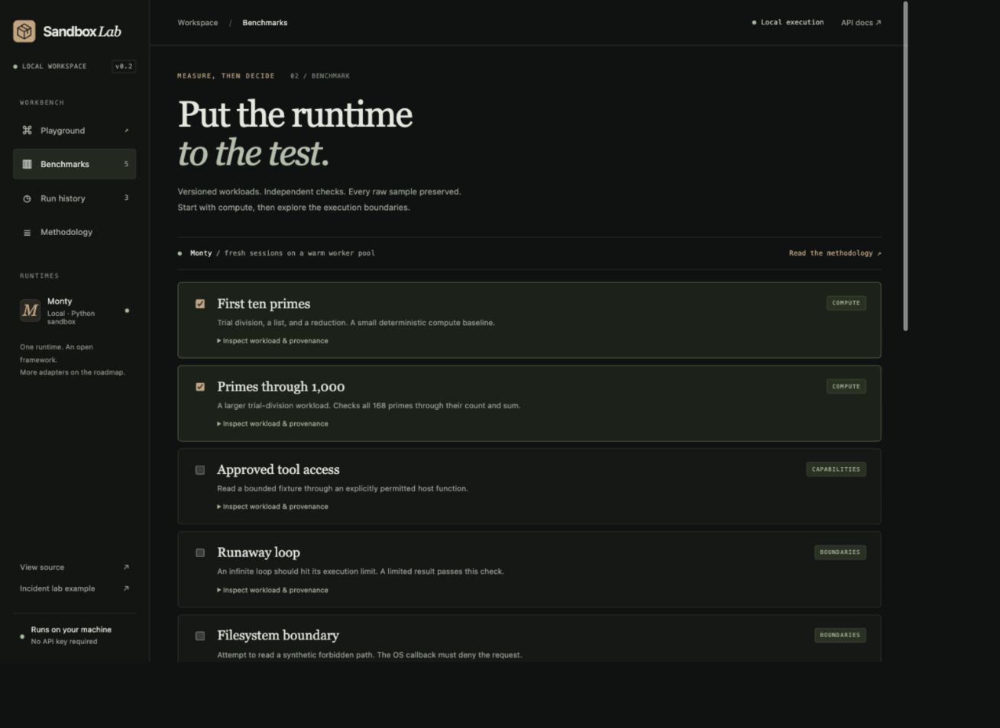

# Sandbox Lab

**Run real code. Test the boundaries. Keep the evidence.**

A local playground for Pydantic Monty with editable Python, explicit host permissions,
repeatable benchmarks, and inspectable execution evidence. This is the first stage
of a provider-extensible sandbox evaluation workbench.



## Run locally

Requires Python 3.14 and [uv](https://docs.astral.sh/uv/). No GPU, Docker daemon,
model API key or Logfire account is needed.

```bash
uv sync --locked
uv run monty-lab serve --port 8033
```

Open **http://127.0.0.1:8033**. The server binds only to loopback.
If macOS marks an editable-install `.pth` file hidden and Python cannot import the
package, use `uv run --no-editable monty-lab serve --port 8033` instead.

## Try the workbench

1. **Playground:** run Hello, Monty or write your own Python. Adjust the execution
   and memory budgets. View output, setup/execution/cleanup timing, and the timeline.
2. **Permissions:** load Approved tool access, disable the fixture tool and run.
   Inspect the recorded denial in Policy audit. Re-enable it to read three records.
3. **Benchmarks:** run the two selected prime workloads with warmups and repeated
   measurements. Add the runaway-loop and filesystem-boundary checks.
4. **Evidence:** export a JSON record or open a previous run from Run history.



## Included workloads

| Workload | Expected result | Origin |
| --- | --- | --- |
| First ten primes | Exact primes, sum 129, average 12.9 | Adapted from AI Sandbox Benchmark |
| Primes through 1,000 | Count 168, sum 76,127 | Adapted from AI Sandbox Benchmark |
| Approved tool access | Three fixture rows, total 60 | Authored here |
| Runaway loop | Execution resource limit | Authored here |
| Filesystem boundary | Explicit OS policy denial | Authored here |

The two compute payloads are adapted from
[nibzard/ai-sandbox-benchmark](https://github.com/nibzard/ai-sandbox-benchmark),
pinned to `c07127e731ec14e55f93dee767977bf00bb76dce`. Attribution, the declared
Apache-2.0 license, and exact modifications are documented in
[THIRD_PARTY_NOTICES.md](THIRD_PARTY_NOTICES.md).

## What the measurements mean

Every trial uses a fresh session on an existing Monty worker pool. Execution time
includes host-to-worker communication and host callbacks. It excludes process
cold start, queue wait and result persistence. These are local exploratory
measurements, not provider rankings or a reproduction of upstream timing results.

Warmups are excluded. Every failed check remains in the exported record. Summary
latencies use passing trials; P95 requires at least 20 passing samples. Configured
memory is an allocator budget, not measured RSS. Passing boundary cases does not
certify a sandbox as secure.

## Use your own client or agent

The local API accepts generated code through the same bounded execution path.
There is no live LLM connection in the new playground yet.

```bash
curl http://127.0.0.1:8033/api/playground/runs \
  -H 'Content-Type: application/json' \
  -d '{"mode":"playground","code":"6 * 7","allow_fixture":false}'
```

The response supplies a run ID. Read `/api/playground/runs/{id}`, follow
`/api/playground/runs/{id}/events`, or download `/api/playground/runs/{id}/export`.
The offline API reference is at `/docs`, with a machine-readable `/openapi.json`.

## Architecture and next steps

- [Architecture and measurement contract](docs/playground-architecture.md)
- [Validation evidence and current limits](docs/playground-validation.md)
- [Roadmap and provider collaboration strategy](docs/roadmap.md)
- [Contribution guide](CONTRIBUTING.md)
- [Original inference incident example](docs/incident-lab.md), still available at `/incident-lab`

One serial runner, a bounded eight-job queue, separate Monty worker processes,
SQLite history, replayable server-sent events, and no frontend build step.
Cancellation stops between bounded trials. Restarted jobs are marked interrupted.

Records persist code and outputs in `artifacts/playground.sqlite3`; do not paste
credentials or private data you do not want stored. This release is a single-user
local application, with no authentication or tenant isolation. Public hosting
requires the controls described in the roadmap.

## Develop

```bash
uv run ruff check .
uv run ruff format --check .
uv run pytest
uv run monty-lab evaluate
```

The original incident acceptance suite remains supported. Tests cover benchmark
oracles, permission denials, resource limits, session isolation, recovery, queue
admission, cancellation, durable history, event replay, export, and request bounds.

Application code: MIT. Adapted prime workloads: Apache-2.0. Design direction
inspired by [AI Bottlenecks](https://aibottlenecks.app/), with original implementation
and assets. No provider partnership or affiliation is implied.
