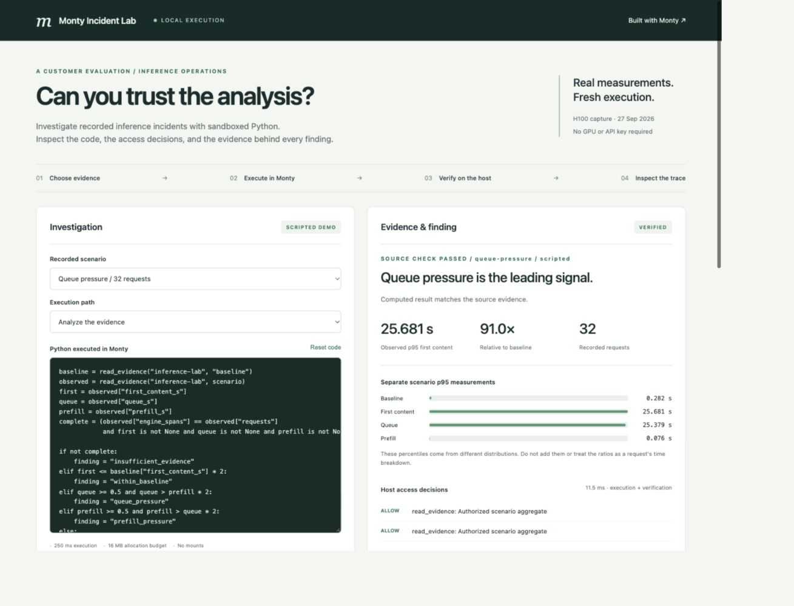
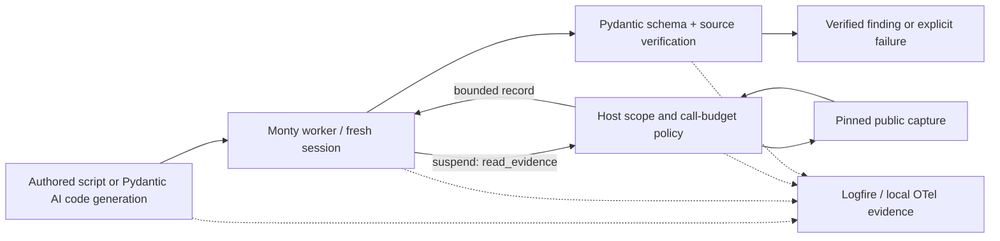

# Monty Incident Lab

**Can an AI-written analysis inspect inference telemetry without unrestricted access to the host, and can we verify its answer?**

This lab makes that question testable. Python runs in Monty, reads a small authorized evidence surface, and returns an analysis that the host independently checks. Logfire connects the investigation, sandbox execution, evidence reads, and validation in one trace. Pydantic Evals exercises the success and failure paths.

The source data is the published H100 capture from [Logfire Inference Lab](https://github.com/rudrakshkarpe/logfire-inference-lab). The default scripts are authored examples. They execute for real on your machine, but do not call an LLM or rerun inference. An optional Pydantic AI path generates code with a live model and runs it through the same boundary.



Actual local demo capture. [Native trace inspector](evidence/trace-inspector.jpg) · [Recorded acceptance evidence](evidence/evaluation.json) · [Validation scope](validation.md)

## Run it

Requires Python 3.14 and [uv](https://docs.astral.sh/uv/). No GPU, API key, Docker daemon, or Logfire account is needed for the default demo.

```bash
uv sync --locked
uv run monty-lab serve
```

Open **http://127.0.0.1:8022/incident-lab**. Choose a scenario, inspect the program, and run it. Use the failure cases to test the boundary. The UI permits editing code and runs only on loopback. It is not a public execution service.

```bash
# Repeatable acceptance suite, with machine-readable evidence
uv run monty-lab evaluate

# A single successful analysis
uv run monty-lab run --scenario long-context

# A deliberate policy rejection; exits nonzero as expected
uv run monty-lab run --challenge cross-scope
```

Results go to `artifacts/`. `traces.jsonl` contains real OpenTelemetry spans, including Monty's native instrumentation.

The UI's **Inspect local trace** control shows completed spans from a bounded recent-span buffer. It exposes IDs, names, scope and timing, while omitting raw code, attributes and host resource identifiers.

Exporting to hosted Logfire requires explicit opt-in:

```bash
# Set LOGFIRE_TOKEN securely in your shell first.
uv run monty-lab --export-logfire serve
```

Native instrumentation records code, inputs, external calls, and errors. This fixture is public. Review the [data and security boundaries](security.md) before using customer data.

## What to demonstrate

| Customer question | Demonstration | Evidence |
| --- | --- | --- |
| Can it investigate our inference latency? | Compare baseline with queue pressure, long context, and recovery | Exact source measurements, computed slowdown, explicit diagnostic rules |
| Can we trust the numbers? | Deliberately return a fabricated request count | Host validation rejects the result |
| Can it access another customer's data? | Request a different scope | Host callback denies the request; no result is accepted |
| Can the code hide a rejected operation? | Catch the permission exception and return a valid answer | Host audit still invalidates the run |
| What if it loops or allocates too much? | Exercise time and memory budgets | Failure is reported, the session ends, a fresh run succeeds |
| What happens when evidence is incomplete? | Investigate early-closed streams | Missing engine evidence remains unknown; no causal diagnosis is accepted |
| Can engineers investigate failures? | Follow the trace ID | Connected application, native Monty, host callback, and validator spans |

The scope check is a demo authorization policy over public fixtures. It is not a tenant authentication implementation.

## How it works



The script can request only baseline and the selected scenario from `inference-lab`, with at most four evidence reads. No mounts, network tools, environment access, or arbitrary host functions are supplied. Code has a 250 ms execution budget, a 16 MB allocator budget, a 24-suspension budget, and a 4 KiB print cap. The pool has two workers and a separate per-turn watchdog.

The validator checks a strict Pydantic schema, observed evidence reads, denied operations, exact references, source values, arithmetic, and the documented diagnostic policy. Pydantic schema validation alone would not detect plausible but fabricated numbers.

## Live code generation

```bash
# Set OPENAI_API_KEY securely. Choose a model available in your account.
# This sends prompts to the provider and may incur charges.
uv run monty-lab run --model openai:YOUR_MODEL_ID --scenario queue-pressure

# Evaluate all four evidence cases with the same model, up to eight requests.
uv run monty-lab evaluate --model openai:YOUR_MODEL_ID --output artifacts/live-evaluation.json
```

Pydantic AI produces a typed `CodeProposal`. The application executes that code in Monty and independently checks its result. A coding or schema error permits one repair attempt. Resource violations and denied capabilities stop immediately. The exported run includes generated code, verification outcomes, model request count, and token usage. Transport failures propagate as failed CLI runs, not verified analyses.

This is a bounded code-writing workflow, not an autonomous remediation agent. The model sees the evidence API contract and diagnostic policy; the generated program reads the measurements. The policy is supplied explicitly, so successful output does not prove open-ended incident reasoning. FunctionModel tests verify the integration without paid requests. See [validation](validation.md) for which paths were actually exercised.

## Evidence and limits

- Historical input: [pinned capture](https://github.com/rudrakshkarpe/logfire-inference-lab/blob/79ef0f2456e64879bd2f41c90d1610a031191495/docs/evidence/gemma4-h100-run.json), unchanged JSON with SHA-256 recorded in every evaluation.
- Separate scenario p95s are **not additive**. Their ratios do not describe a single request's latency breakdown. The findings identify signals, not proven causes.
- Missing engine spans after early close do not establish server-side cancellation.
- The evaluation covers a small fixed set of application contracts. It is neither a security certification nor a model-quality or throughput benchmark.
- Monty is a language sandbox. Host callbacks still execute with host privileges. The allocation budget is not an RSS limit.
- No live model-quality score or hosted ingestion claim is made by the scripted evaluation.

## Deliver the customer demo

- [Discovery and 10-minute demonstration](customer-playbook.md)
- [Security boundaries and production gaps](security.md)
- [Reproducible validation and evidence](validation.md)
- [Architecture decisions and learning path](architecture.md)

## Develop

```bash
uv run ruff check .
uv run ruff format --check .
uv run pytest
```

MIT licensed. The original capture is reused from the author's MIT-licensed inference lab; attribution is in [NOTICE](NOTICE).
