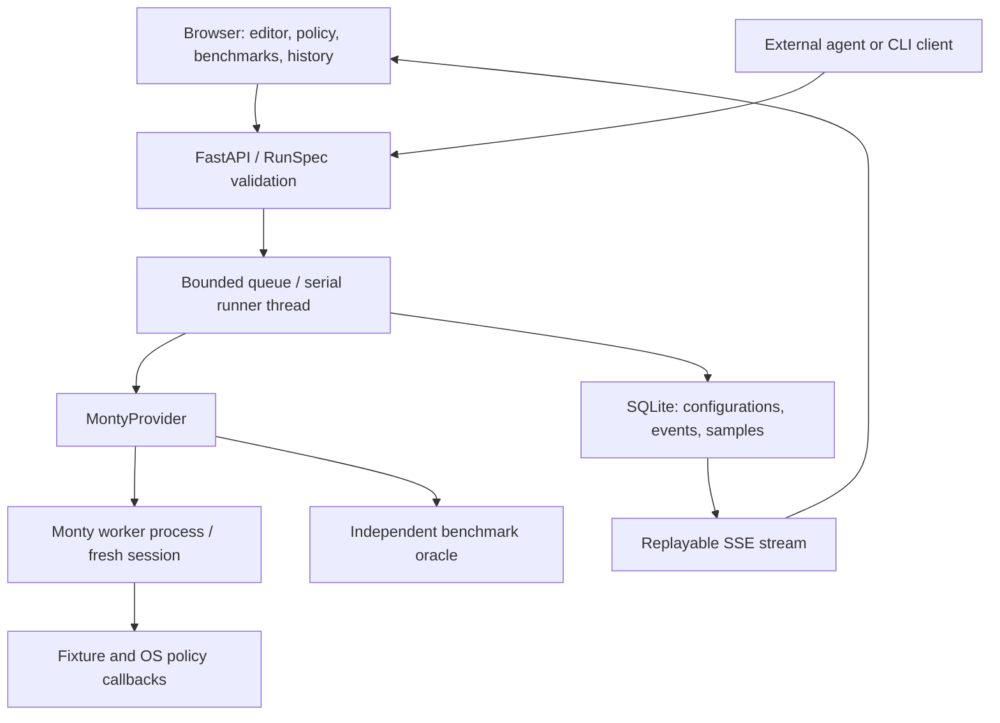

# Sandbox Arena architecture

## Scope of this release

An executable local Monty workbench, not a mock leaderboard. No provider keys,
model calls or external telemetry export are required. The original incident
investigation remains available at `/incident-lab` and through its CLI commands.

The Python runner thread orchestrates trials; untrusted Python executes only in
Monty's separate worker process. The existing worker pool is shared with the
incident example. Do not run that example concurrently when measuring baselines.
Host callbacks execute with host privileges, so they accept no arbitrary code,
paths, URLs, credentials, or user-configurable Python functions. The only exposed
tool returns a fixed three-record fixture. Filesystem operations reach an explicit
denial callback. No network tool is exposed.

## Contracts

- `playground_models.py`: validated RunSpec and Sample records.
- `benchmarks/`: immutable workload IDs, versioned payloads, required capabilities,
  expected outcomes, pinned upstream provenance.
- `playground_runner.py`: Provider protocol, Monty adapter, admission control,
  worker lifecycle, correctness checks, statistics, and durable storage.
- `playground_api.py`: run submission, polling, event replay, cancellation,
  paginated history, and JSON export.
- `static/playground.*`: dependency-free web interface served from this package.

The Provider protocol is the initial extension seam, not a finished multi-provider
SDK. The request type and environment metadata currently accept Monty only. A new
adapter must add a registry entry, capability compatibility checks, provider-specific
configuration validation, and conformance tests. Unsupported capabilities must be
reported explicitly, never represented as failed performance results.

## Lifecycle and failure behavior

`queued → running → completed | cancelled | failed`

On restart, abandoned queued or running jobs become `interrupted`. Completed means
the runner finished the experiment; it does not mean every benchmark passed.
Every sample separately records execution status and an independent verdict.
Custom code has an `unverified` verdict because it has no correctness oracle.

One runner thread executes trials serially. Eight admitted jobs are allowed,
including the active job; additional submissions receive HTTP 429. Cancellation
sets a flag checked between bounded trials. It does not claim instantaneous
interruption of the current Monty call. Native worker deadlines bound that call.
The server closes its runner before closing the Monty pool.

SSE events have monotonically increasing per-run IDs and support Last-Event-ID
replay. Disconnecting the browser does not cancel the job. History recovers its
configuration and evidence. A full-page reload does not automatically resume the
selected UI view; open the run from history.

## Evidence and timing

Each export includes schema version 1.0, runtime package version, Python version,
OS, architecture, policy, workload source and revision, exact code, code hashes,
warmups, raw samples, checks, and events. The local SQLite database is
`artifacts/playground.sqlite3`. Source code and outputs are persisted there; never
paste secrets into the playground. The history endpoint reads compact metadata
with a limit of 100 records per page. Raw data is retained without automatic expiry;
production needs storage quotas and a retention policy.

- Setup: session checkout in an existing worker pool.
- Execution: host wall-clock duration of `feed_run`, including IPC and callbacks.
- Cleanup: session release and immediate exception handling.
- Total: sum of these stages; queue delay, UI delivery, validation, persistence,
  process startup, and JSON export are outside this timer.
- Memory: configured Monty allocator budget, not measured RSS or peak memory.

Warmups run the same workload in discarded sessions and never enter the summaries.
Only passing measured trials enter timing statistics, but all failures are counted
and preserved. Median, range and sample count are always shown when available.
Nearest-rank P95 requires 20 passing samples. There is no P99 or composite rank.
This threshold prevents the smallest exploratory runs from displaying a tail
estimate; it does not make 20 samples a statistically strong performance study.

Record environment load and repeat experiments when making a performance claim.
These adapted prime workloads are not directly comparable to the upstream
framework's decorator timings or remote provider results.

## Local boundary and hosting gate

The CLI binds to 127.0.0.1. The app validates Host and browser Origin, bounds POST
bodies to 64 KB, requires JSON, serves local assets under a restrictive CSP, and
renders guest output as text. Code is capped at 12,000 characters; output at 4 KiB;
return previews at 16,384 characters. Trial limits and warmups are bounded.
No arbitrary host `exec`, `eval`, shell commands or package installation is used.

This is a single-user development service. It has no authentication, tenant model,
managed secrets, per-user rate limits, process RSS enforcement, distributed leases,
or public abuse controls. Do not expose it by simply changing the bind address.
The hosted path is described in the roadmap.
